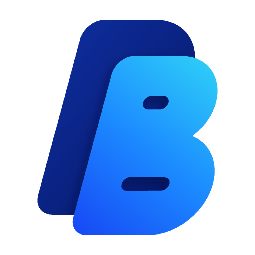
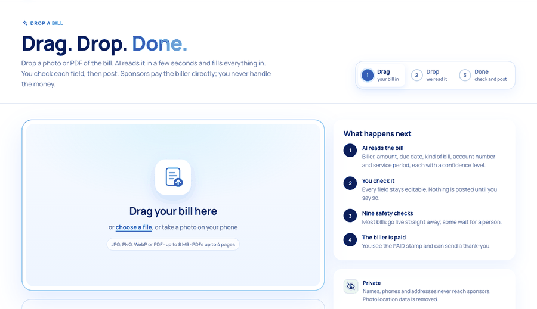
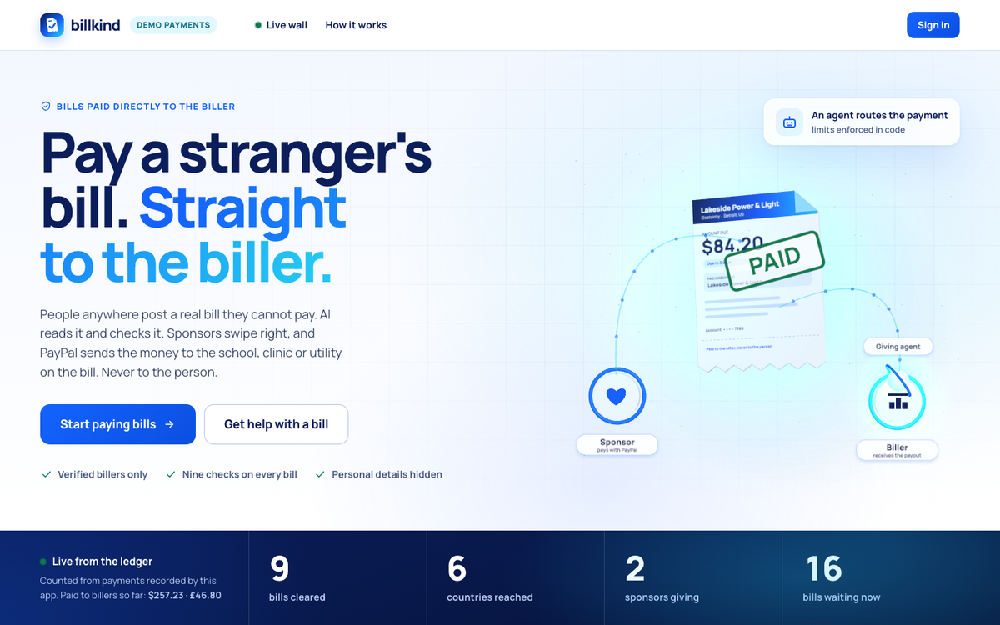
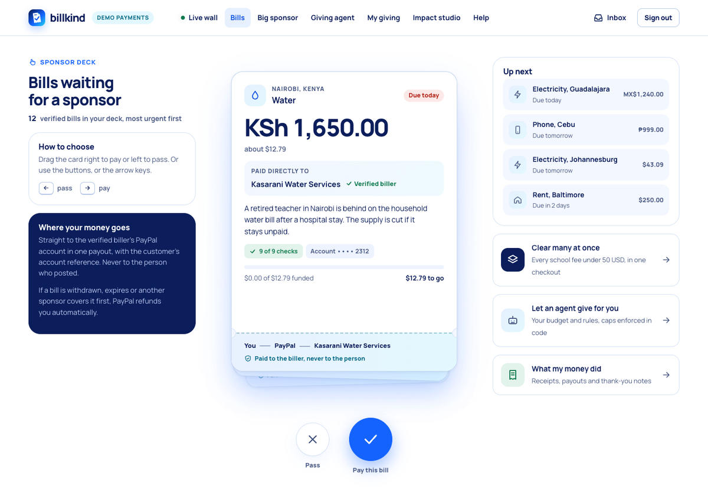
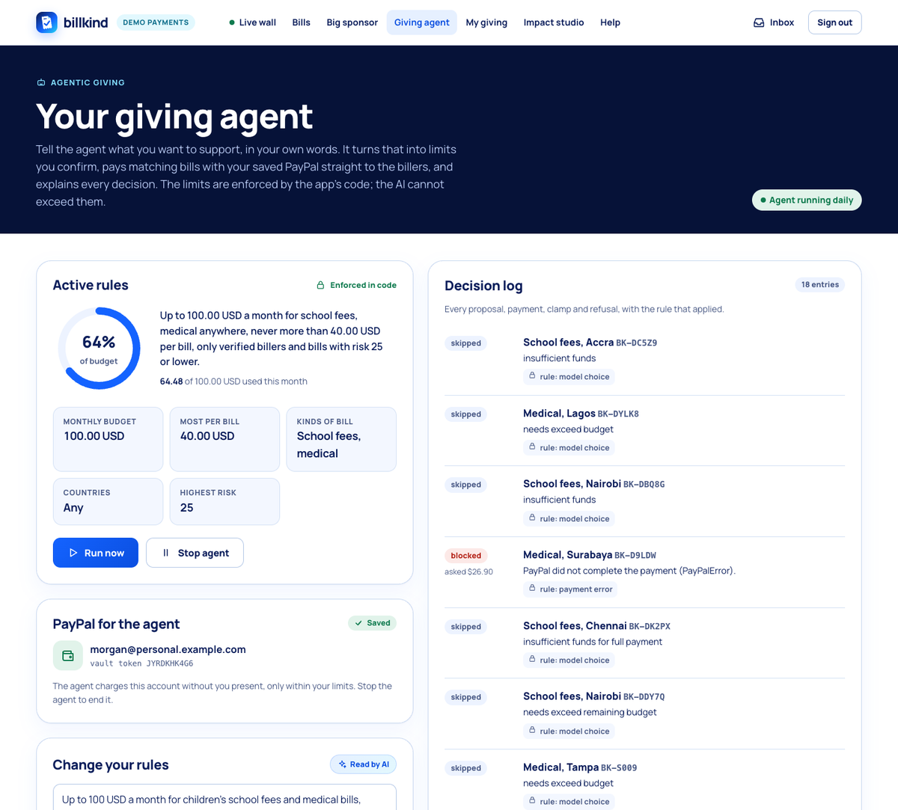
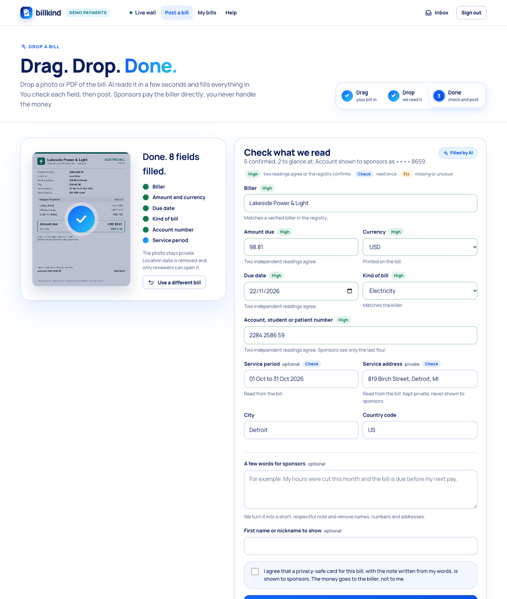

# Billkind

**Post a bill you cannot pay. A stranger pays it. The money goes to the biller, never to the person.**

Billkind is a real, safe version of a viral joke about an app where you upload your bills and bored billionaires swipe right to pay them. People anywhere post a real bill (electricity, water, school fees, a clinic invoice, rent, a phone bill). Sponsors swipe through verified, privacy-safe bill cards and pay them with PayPal. When a bill is covered, Billkind sends one PayPal payout to the biller's verified account, and the sponsor watches the paid stamp, the receipt and the thank-you arrive live.

Built for the PayPal AI Hackathon 2026. Sandbox only: no real money moves.

| | |
|---|---|
| Live demo | https://billkind.140-245-16-129.sslip.io |
| Demo video | https://youtu.be/dtZiq1pcscs |
| Video music | Music: "Light Thought var 1" Kevin MacLeod (incompetech.com)<br>Licensed under Creative Commons: By Attribution 4.0 License<br>http://creativecommons.org/licenses/by/4.0/ |
| License | MIT |

## Drop a bill



**Drag. Drop. Done.** A person drops a photo or PDF of a real bill (or takes a photo on a phone). Billkind reads it with an open vision model and fills in the form: biller, amount and currency, due date, kind of bill, account or reference number, service period and service address. Every field shows a confidence level worked out in code, not taken from the model on its own:

| Level | When |
|---|---|
| High | Two independent readings agree (the vision model and Tesseract OCR), or the biller matches the verified registry |
| Check | Read once and nothing contradicts it |
| Fix | Missing, the two readings disagree, or the value breaks a bill rule: a currency Billkind cannot settle, an amount above the open-bill limit or far from a typical bill of that kind, a due date months away or long past |

Every field stays editable and nothing is posted until the person confirms; then the same nine safety checks run. No bill handy? Drag one of four fictional sample bills (electricity, school fees, water, clinic) onto the drop zone, or press **Try a sample bill**. Each sample is generated fresh on every request, so it never trips the duplicate checks.

Privacy and safety: files are checked by their bytes (JPEG, PNG, WebP or PDF only, up to 8 MB, PDFs up to 4 pages). The private copy kept for reviewers is re-encoded without EXIF or GPS, and PDFs are rewritten with their pages only, without document metadata. The stored reading keeps only the last four characters of the account number; the full number lives in one private column and goes only to the biller in the payout note. The original file is never on a public page. Readings are capped at eight per poster in ten minutes, and the vision model gets a downscaled copy, one model call at a time, to stay inside Groq's free-tier tokens per minute; if it is rate limited, a text model reads the OCR text, and without any AI the regex reading still fills the form. Code: [app/ai/dropbill.py](app/ai/dropbill.py), [app/ai/intake.py](app/ai/intake.py).

What it gives the rest of the app: sponsor cards show **Read from the bill** when both readings of the uploaded document agreed on the amount, and the giving agent receives each candidate bill's verified biller, due date and what its document confirms, and is told to prefer document-confirmed bills when others are alike. Its hard caps are unchanged and still live in code.

| | |
|---|---|
|  |  |
| **Landing page.** A small 3D scene: the giving agent carries the payment, the bill is stamped PAID, the biller is paid. | **Swipe deck.** Verified bills, most urgent first, paid straight to the biller. |
|  |  |
| **Giving agent.** Plain-words rules become hard limits; every decision is logged. | **Check what we read.** Each field with its confidence and the reason. |

## Try it in two minutes

Open the live demo, choose **Sign in**, and use the one-click demo accounts. No password needed.

| Account | What to try |
|---|---|
| Sponsor (`sponsor@billkind.demo`) | **Bills**: swipe right (or press the right arrow) on a bill, pay, and watch the steps tick through to PAID. **My giving** shows every payment with its PayPal order, capture and payout IDs. **Impact studio** turns it into an AG Studio dashboard; ask the assistant for a new view. |
| Big sponsor (`bigsponsor@billkind.demo`) | **Big-sponsor mode**: type "Clear every school fee bill under 60 USD" and pay them all in one checkout. **Giving agent**: its PayPal is already saved and its rules are set, so press **Run now** and read the decision log. The budget is per calendar month across all of this sponsor's agent payments. So that every judge can try it, this demo account gets a fresh budget once it is used up (at most every 15 minutes); the renewal shows in the decision log as its own entry. You can also write new rules with a higher monthly budget (up to 5,000 USD), confirm, and run again. Earlier payments and decisions are never changed. |
| Poster (`poster@billkind.demo`) | **Post a bill**: drag a sample bill onto the drop zone (or press **Try a sample bill**, or drop your own photo or PDF), watch it fill in, check each field, add a few words, and post. Each browser gets its own poster account. |
| Admin (`admin@billkind.demo`) | Review queue with risk reasons and the original document, biller registry, payout problems, support tickets, the webhook log and the PayPal and AI call logs. The Operations studio (AG Studio) is linked from the console. |
| Biller (`biller@billkind.demo`) | Payouts received, with the customer account number from each payout note. |

The **Live wall** (no sign-in) shows bills being cleared around the world. Every number on it is counted from transactions recorded by the app; nothing is pre-filled.

Payments run in the real PayPal sandbox. When the PayPal window opens, log in with one of these sandbox test buyers (sandbox test accounts with play money, created for judges; no real money):

| Sandbox buyer | Email | Password |
|---|---|---|
| Sponsor (5,000 USD balance) | `billkind-sponsor@personal.example.com` | `BkbbDm2qs7lh7!` |
| Second sponsor (2,000 USD balance) | `billkind-sponsor2@personal.example.com` | `BkAV7o8n8nq97!` |

Billers are paid into a sandbox business account (`billkind-biller@business.example.com`) that stands in for every demo biller. Without credentials (for example a fresh local clone), Billkind falls back to its built-in PayPal fake, where a neutral "sandbox payment simulator" window stands in for the PayPal login.

Suggested path for judges: sign in as Poster in one browser window and drop a sample bill (the electricity bill from Detroit is paid and paid out in USD). Sign in as Sponsor in a private window, swipe right on that bill and pay. Watch the PAID stamp appear in both windows, then send a thank-you as the poster and watch it reach the sponsor.

### Proof it ran in the real PayPal sandbox

These payments were made on the hosted demo while recording the video, with the sandbox buyers above. The IDs are PayPal sandbox IDs (play money). Six captured orders touched eight bills, sent six payouts to the sandbox biller account and made one full refund.

| What | Amount | PayPal order | Capture | Payout items to the biller |
|---|---|---|---|---|
| Sponsor swipes right on bill BK-JUBVJ | 40.24 USD | `7NC65463DM613935T` | `4VT22118HH4366927` | `LTFLRA5VUPDRU` |
| Big-sponsor mode: three school fee bills in one checkout | 92.57 USD | `15M59621PW1943615` | `8X915866A3615341B` | `3R9QX34NZWKCU` (BK-S010, 33.14 USD), `A9JCPTYC8XTRE` (BK-S015, 24.81 USD), `ZS6LF78MQ8VSN` (BK-S011, 34.62 USD) |
| Giving agent, Vault payment, BK-S013 (medical, Surabaya) | 26.90 USD | `07516995UD866213K` | `1NY31948HD8370839` | `ZPKU88CB2SNBL` |
| Giving agent, Vault payment, BK-S003 (medical, Lagos) | 37.58 USD | `9CD57971W9445682L` | `8B386022102406219` | `WR42EUWRYBC48` |
| Giving agent, Vault payment, BK-S004 (medical, Quezon City), clamped to the 35.52 USD left in its budget | 2,042.40 PHP | `6JT20207YC995343B` | `51X60438WV981014G` | none yet: the bill was 49% funded and stayed open |
| Sponsor chips in on bill BK-YA7LD, then the poster withdraws the bill | 10.00 USD, refunded in full | `3P972633RA982833G` | `3964210366728263B` | none: refunded through Payments v2 |

## Why it matters

| Fact | Source |
|---|---|
| 37% of US adults would not cover a 400 USD emergency with cash. | Federal Reserve, Economic Well-Being of U.S. Households in 2025 (May 2026) |
| One in six US households is behind on utility bills; utilities disconnected electric service about 13.5 million times in 2024. | NEADA, June 2026 |
| Families in India spend on average 25,002 INR a year per student in non-government schools; 1.2% rely mainly on scholarships. | MoSPI NSS 80th round, 2025 |
| Of 437,596 US medical crowdfunding campaigns, 12% met their goal and 16% received nothing. | American Journal of Public Health, 2022 |
| 67.7% of donors say trust is essential, but 18.3% highly trust charities. | Give.org Donor Trust Report 2026 |

Small bills never get a crowdfunding campaign, and givers want to know exactly what their money did. Paying a verified biller directly answers both. Full sources are in [DESIGN.md](DESIGN.md).

## How fraud is stopped

The core rule removes the incentive: **money only moves to a verified biller's PayPal account, never to the poster.** The worst a dishonest poster can do is get someone's real bill paid.

On top of that, every bill passes nine checks before it can be paid: verified biller registry, editing-software traces in the file, visual editing signs, two independent readings of the amount and date (a vision model and OCR), line items adding up, a typical amount for the kind of bill, a sensible due date, duplicates (same file, near-identical image with the same amount, same account and amount), and posting velocity per account and device. The result is a 0 to 100 risk score with every reason in plain words. Low-risk bills list automatically, others go to a person, and hard failures such as an already-paid bill are refused with the reason shown. Code: [app/ai/fraud.py](app/ai/fraud.py).

Account numbers are masked to the last four characters, and names, phone numbers, emails and addresses are removed before anything is public ([app/ai/redact.py](app/ai/redact.py)). The full account number is sent only to the biller, inside the payout note. Uploaded photos lose their EXIF and GPS data and PDFs their metadata before they are stored, and the original file is visible only to reviewers.

## PayPal APIs used

| API | What Billkind uses it for | Code |
|---|---|---|
| OAuth 2.0 client credentials | Access tokens (cached; the SDK manages its own) | [app/paypal/client.py#L102](app/paypal/client.py#L102) |
| PayPal Server SDK for Python (`paypal-server-sdk`, generated by APIMatic) | All Orders, Payments and Vault calls below run through it; a plain REST path is kept behind `PAYPAL_SDK=rest` | [app/paypal/client.py#L35](app/paypal/client.py#L35) |
| Orders v2: create order | Every sponsor payment. One purchase unit with one item per bill, so big-sponsor mode pays many bills in one checkout. `PayPal-Request-Id` for idempotency. | [client.py#L135](app/paypal/client.py#L135), [funding.py#L88](app/core/funding.py#L88) |
| Orders v2: capture, get order | Capturing after buyer approval, and reconciling from webhooks | [client.py#L180](app/paypal/client.py#L180), [funding.py#L166](app/core/funding.py#L166) |
| JS SDK Buttons | Buyer approval in the browser, loaded per currency with `data-namespace` | [app/web/static/pay.js#L6](app/web/static/pay.js#L6), [deck.html](app/web/templates/deck.html) |
| Payments v2: refund capture | Full and partial refunds: withdrawn or expired bills, overfunding, late captures, failed payouts | [client.py#L197](app/paypal/client.py#L197), [funding.py#L243](app/core/funding.py#L243) |
| Payouts v1: create batch, get batch | Paying billers. One batch with one item per funded bill; the payout note carries the bill ID and customer account number. Polling is the fallback when a webhook is late. | [client.py#L212](app/paypal/client.py#L212), [funding.py#L322](app/core/funding.py#L322) |
| Vault v3: setup token, payment token | Sponsors save PayPal once for the giving agent and for monthly sponsorships | [client.py#L241](app/paypal/client.py#L241), [main.py vault routes](app/main.py) |
| Orders v2 with `payment_source.paypal.vault_id` | Merchant-initiated payments by the giving agent and recurring sponsorships, without the sponsor present | [client.py#L135](app/paypal/client.py#L135), [agent.py#L140](app/ai/agent.py#L140), [automation.py#L58](app/core/automation.py#L58) |
| Webhooks: self-verification | CRC32 of the raw body, `transmission_id|time|webhook_id|crc32` signed with SHA256withRSA, certificate URL restricted to paypal.com hosts | [app/paypal/webhooks.py#L80](app/paypal/webhooks.py#L80) |
| Webhooks: verify-webhook-signature API | Fallback when the certificate cannot be fetched | [client.py#L268](app/paypal/client.py#L268) |
| Webhook events handled | `CHECKOUT.ORDER.APPROVED` (server-side capture if the browser never returned), `PAYMENT.CAPTURE.COMPLETED / DENIED / DECLINED / REFUNDED`, `PAYMENT.PAYOUTSBATCH.*`, `PAYMENT.PAYOUTS-ITEM.SUCCEEDED / UNCLAIMED / RETURNED / FAILED / BLOCKED / ...`, `VAULT.PAYMENT-TOKEN.CREATED` | [app/core/webhook_handlers.py#L33](app/core/webhook_handlers.py#L33) |
| PayPal Agent Toolkit (Python, official) | The support assistant reads live order status through the toolkit's `get_order_details` tool, limited to the signed-in user's own orders | [app/paypal/toolkit.py](app/paypal/toolkit.py), [app/ai/support.py](app/ai/support.py) |

Multi-currency: bills keep their own currency for display, with the sponsor's currency shown alongside. Bills in a currency PayPal supports for cross-border payments (USD, EUR, GBP, MXN, PHP and others) are paid and paid out in that currency. Bills in other currencies (INR, KES, NGN, GHS, ZAR, IDR) settle in USD at an indicative rate shown on the card.

## AG Studio: the Impact studio

Billkind uses **AG Studio 3.1** (AG Grid's embedded analytics component) for two dashboards:

| Page | Who | What it shows |
|---|---|---|
| `/insights` (nav: Impact studio) | Sponsors | "What my money did": given after refunds, bills supported, countries, billers paid, the money path, giving by country and by kind of bill, how they gave (swipe, big-sponsor mode, giving agent, monthly sponsorship), a paid ledger with PAID stamps, and every payment with its PayPal order and capture IDs. A second page shows where the giving agent spent its budget: decisions by outcome, the rules that applied and the full decision log. |
| `/admin/insights` (link in the admin console) | Admin | "Risk, payouts and webhooks": bills by status, average risk score, which fraud signals fire most, payout outcomes, webhook verification, payouts to billers with time to final status, and money movement by currency and source. |

How it is built:

- **Server-scoped data.** [`app/core/insights.py`](app/core/insights.py) builds the Studio data sources (payments, bills, agent decisions; for admins also risk signals, payouts and webhooks) with relationships, field names and formats, and primary keys. A sponsor only ever receives their own rows; no names, account numbers or emails leave the server. Served by `GET /api/insights/data` ([`app/web/insights_routes.py`](app/web/insights_routes.py)).
- **Built-in reports in code.** The report pages are Studio state JSON in [`app/web/static/insights.js`](app/web/static/insights.js): value KPIs, grouped bar and donut charts, grids, and an empty "My own view" page. Users can rearrange everything in edit mode; their layout is kept in their browser, and "Reset to the built-in report" restores it.
- **Two custom widgets** registered with `createWidgets`: **Money path** (you, PayPal, billers paid, with "never to the person") and **Paid ledger** (bills with a PAID stamp once the PayPal payout to the biller succeeded). Both load their data through `widgetApi.getData`, so filters and cross-filters apply.
- **Theme** from the Billkind palette through `studioTheme.withParams` and the chart palette CSS variables.
- **Live data.** The page listens to Billkind's server-sent events. When PayPal confirms a capture, payout or refund, the page refetches and applies only the changed rows as `applyTransaction` calls on Studio's data engine, so only the affected widgets re-query.
- **A custom agent in the Studio Agent Framework.** "Ask your impact" in Studio's chat panel is a Billkind agent built with `clientToolRunner`. Each round goes to `POST /api/insights/agent` ([`app/ai/insights_agent.py`](app/ai/insights_agent.py)), which asks `openai/gpt-oss-120b` on Groq for the next step; the key stays on the server and the model sees only a schema summary of the user's own data. The model acts through a custom Studio tool, `place_widget`, defined with `api.defineAiTool` and a shape-validated schema whose field enums come from the live data; Studio executes it in the browser to add the widget. Tool names are allowlisted on the server, rounds are capped, and the reply may not state numbers (the widget shows them).
- **Licence.** AG Studio is commercial. The 45-day trial key is read from `AG_STUDIO_LICENSE_KEY` and set with `AgStudioLicenseManager.setLicenseKey` at runtime; it is not in the repository. Without it Studio runs with a watermark. The library loads from jsDelivr at a pinned version (`ag-studio@3.1.0`, UMD build) only on these two pages.

## AI used

All models are open-weight models served by Groq. Every AI feature has a non-AI fallback, and no AI output alone can move money.

| Feature | Model | Fallback |
|---|---|---|
| Drop a bill: reading a photo into structured fields with a confidence per field | `qwen/qwen3.8-27b` (vision, JSON output); if it is unavailable or rate limited, `openai/gpt-oss-120b` reads the OCR text | Tesseract OCR and a regex parser; confidence comes from comparing the two readings in code |
| Reading a PDF bill | `openai/gpt-oss-120b` on the PDF text; a scanned PDF's page image goes to the vision model | Regex parser |
| Visual editing signs (one of the nine checks) | Vision model | Rule checks only |
| Dignified note from the poster's own words, with consent | `openai/gpt-oss-120b` | Template; redaction runs on both |
| Big-sponsor filter from plain words | `openai/gpt-oss-120b` | Keyword parser |
| Giving agent: rules to limits, then choosing bills with reasons | `openai/gpt-oss-120b` | Rule parser and most-urgent-first picker |
| Support assistant with tool calls | `openai/gpt-oss-120b` | Answers built directly from the user's records |
| Impact studio agent (AG Studio Agent Framework) | `openai/gpt-oss-120b`, falling back to `openai/gpt-oss-20b` on rate limits | Drag-and-drop editing in Studio |
| Thank-you polish (optional) | `openai/gpt-oss-120b` | The poster's own text |

Guardrails that live in code, not prompts:
- **Giving agent caps** ([app/ai/agent.py](app/ai/agent.py)): monthly budget, per-bill cap, categories, countries, maximum risk, verified billers only, never more than a bill still needs. The model proposes; code pays, clamps or refuses, and logs the rule that applied.
- **Support grounding** ([app/ai/support.py](app/ai/support.py)): the assistant sees only the user's own records, policies and their own PayPal orders. Every amount, date and ID in its answer is checked against the tool output; if anything is not found, the answer is replaced with one built from the records, and a human ticket is offered.

## What is real and what is simulated

| Real | Simulated or limited |
|---|---|
| Every PayPal call listed above runs against the real PayPal sandbox on the hosted demo, including real webhooks verified with PayPal's certificate | A local clone without credentials uses the built-in PayPal fake ([app/paypal/fake.py](app/paypal/fake.py)) with the same endpoints, payload shapes, signed webhooks and error codes |
| AI extraction, fraud checks, notes, agent decisions and support answers from live model calls | Seeded open bills and billers are fictional demo data; nothing is pre-paid. When fewer than six seeded bills (or fewer than two school fee bills under 60 USD) are still open, the demo re-lists fresh copies of the fictional bills with new IDs, new due dates and new demo households ([app/core/automation.py](app/core/automation.py)); this runs only with the sandbox or the local fake and can be turned off with `DEMO_SELF_HEAL=0` |
| Payment state machine, refunds, payouts, webhooks, live updates | One sandbox business account receives payouts for every demo biller; real billers would need onboarding and verification |
| Live wall counts from the database | Exchange rates for display and non-PayPal currencies are indicative and fixed (dated in the UI) |
| | No email is sent; receipts and notices live in the in-app inbox |

Where it can pay today: every demo biller is paid into one US sandbox business account. Bills in a currency PayPal pays out in (in the demo USD, EUR, GBP, MXN and PHP) are paid out in that currency, with one retry in USD if PayPal refuses it, and bills in INR, KES, NGN, GHS, ZAR and IDR settle and pay out in USD. A real biller also needs a PayPal business account in a region where it can receive Payouts: an India-region business account gets `PAYOUT_NOT_AVAILABLE`, so an Indian school would need a PayPal-supported payout region or a partner payout rail. The first real audience that fits what works now is US households and US billers paid in USD, for example a utility shutoff notice under 100 USD, once the steps in "Path to production" are done.

## Run it locally

Requirements: Python 3.12, and Tesseract for the OCR fallback (`brew install tesseract` or `apt install tesseract-ocr`).

```bash
python3.12 -m venv .venv
.venv/bin/pip install -r requirements.txt
.venv/bin/pip install --no-deps paypal-agent-toolkit==1.11.0
cp .env.example .env            # add GROQ_API_KEY for AI; leave PayPal empty to use the local fake
.venv/bin/python -m scripts.seed --reset   # add --refresh-demo later to re-list used demo bills
.venv/bin/uvicorn app.main:app --port 8800
```

Open http://localhost:8800. Without a Groq key the non-AI fallbacks run; without PayPal credentials the local PayPal fake runs.

### Use the real PayPal sandbox

1. On developer.paypal.com, create sandbox accounts in a region where Payouts is available (US works; India-region business accounts get `PAYOUT_NOT_AVAILABLE`): a Business account for the platform, a Business account for billers and a Personal account for sponsors.
2. Create a sandbox REST app linked to the platform business account with Accept payments, Save payment methods (Vault), Payouts and Transaction search enabled.
3. Set in `.env`: `PAYPAL_MODE=sandbox`, `PAYPAL_CLIENT_ID`, `PAYPAL_CLIENT_SECRET`, `BILLER_SANDBOX_EMAIL` (the biller business account), then reseed.
4. Add a webhook pointing at `https://<your host>/webhooks/paypal` with the events listed above, and set `PAYPAL_WEBHOOK_ID`.

Without a reachable webhook URL (for example on localhost), Billkind still completes every flow: captures are recorded from the capture response and payouts are polled.

### Tests

```bash
.venv/bin/python -m pytest -q
```

84 tests run in about fifteen seconds against a real HTTP server and the PayPal fake (83 run by default; the 84th is the opt-in contract test against the real sandbox, described below). They cover drop a bill (file type and size checks, the PDF page cap, EXIF, GPS and PDF metadata removed from stored copies, parsing and cleaning the model's output, validation against the bill rules, confidence from two readings and the registry, account redaction, the scan endpoint with the model mocked through to a listed bill, refusals, the per-poster limit, the no-AI fallback, fresh samples, and what the giving agent sees), money handling, both state machines, webhook signature verification (tampered body, wrong webhook ID, look-alike certificate domains), every fraud rule, the full swipe-to-payout flow, pooled funding, the overfunding hold, late-capture refunds, withdrawal refunds, unclaimed payouts with admin refunds, bulk checkout with one payout batch, forged and replayed webhooks, giving-agent caps when the model overreaches, the demo upkeep (re-listed bills and budget renewal, never outside the sandbox), monthly sponsorship, support grounding and escalation, Impact studio data scoping and the Studio agent round trip, and contract tests that run every PayPal call through both the APIMatic SDK and plain REST. `PAYPAL_CONTRACT_SANDBOX=1` adds a contract test against the real sandbox, and `python -m scripts.sandbox_check <receiver email>` checks orders in six currencies, Vault and payouts on a sandbox app.

### Deploy

The live demo runs on an Oracle Cloud Always Free VM: one Docker container (Python 3.12, Tesseract, uvicorn on port 8800) behind Caddy, which provides HTTPS, with the SQLite database and uploads on a host volume. It starts the same way as the Modal app (open the database, seed only if empty, serve) with the PayPal sandbox and the background jobs on.

`modal deploy modal_app.py` is the earlier host and still works: it runs one container with SQLite backed up to a Modal Volume. It scales to zero when idle and wakes on the next request or PayPal webhook, then stays up for 20 minutes after the last request. Secrets are read from `.env` at deploy time.

## Project layout

```
app/
  main.py            routes and pages
  paypal/            client (SDK and REST), webhook verification, Agent Toolkit wrapper, local PayPal fake
  core/              state machines, funding and payouts, posting, billers, events (SSE), automation, jobs
  ai/                intake, drop a bill (confidence and validation), fraud, redaction, notes, matching,
                     bulk filter, giving agent, support assistant
  web/               Jinja templates, CSS, pay.js, the 3D landing hero (hero3d.js, three.js r160 vendored)
scripts/             seed data and the sample bill generator
samples/             fictional sample bills
tests/               unit, integration and contract tests
DESIGN.md            problem, audience, safety model, state machines, path to production
```

## Path to production

Billkind runs only in the PayPal sandbox. Going live would need PayPal live approval for Payouts and Vault, KYC for posters and businesses, a regulatory review of holding and paying out funds (a PayPal platform model where the biller is the payee, or a licensed fiscal sponsor), sanctions screening and a data-protection review. Details in [DESIGN.md](DESIGN.md#8-path-to-production-not-claimed-for-the-hackathon).
